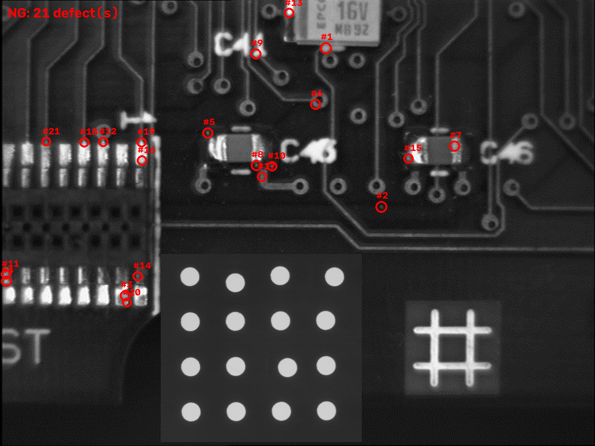
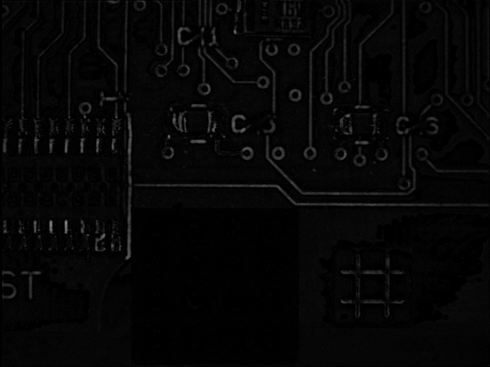
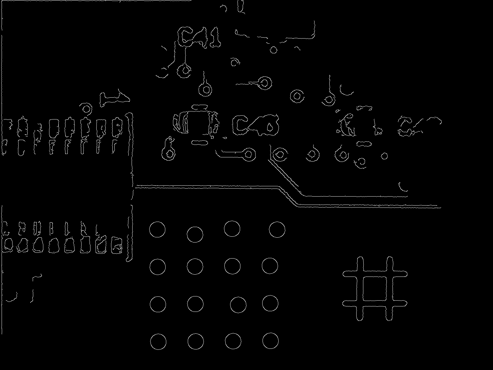

# 瑕疵檢測報告：NG_1.bmp

- 執行時間：2026-10-21 00:11:16
- 檢測模式：無參考模式（頂帽運算 + SimpleBlobDetector）
- 待檢影像：`D:\GitHub\MBA_Lab1\Imgs\Final_Images\NG_1.bmp`
- 影像尺寸：1536 x 1152

## 參數

| 參數 | 值 |
|------|----|
| 頂帽結構元素 `--tophat-size` | 15 px |
| 最小面積 `--min-area` | 8 px |
| 最大面積 `--max-area` | 150 px |
| 最小圓度 `--min-circularity` | 0.7 |
| 最大半徑 `--max-radius` | 不限 |
| Canny 低/高門檻 | 50 / 150 |

## 判定結果

**NG**，共 21 個瑕疵

| # | 圓心 X | 圓心 Y | 半徑 (px) | 面積 (px) |
|---|--------|--------|-----------|-----------|
| 1 | 841 | 124 | 5.1 | 83 |
| 2 | 984 | 534 | 5.0 | 77 |
| 3 | 323 | 763 | 4.3 | 58 |
| 4 | 16 | 726 | 4.2 | 55 |
| 5 | 536 | 343 | 4.2 | 54 |
| 6 | 814 | 269 | 4.2 | 54 |
| 7 | 1173 | 377 | 4.1 | 52 |
| 8 | 661 | 427 | 3.8 | 44 |
| 9 | 660 | 139 | 3.5 | 39 |
| 10 | 702 | 429 | 3.5 | 38 |
| 11 | 15 | 708 | 3.5 | 38 |
| 12 | 266 | 366 | 3.2 | 32 |
| 13 | 746 | 33 | 3.0 | 29 |
| 14 | 355 | 713 | 2.8 | 25 |
| 15 | 1054 | 409 | 2.8 | 25 |
| 16 | 366 | 414 | 2.7 | 23 |
| 17 | 676 | 456 | 2.7 | 23 |
| 18 | 217 | 367 | 2.7 | 22 |
| 19 | 365 | 367 | 2.6 | 21 |
| 20 | 327 | 781 | 2.1 | 13 |
| 21 | 119 | 365 | 1.8 | 10 |

## 輸出檔案

| 檔案 | 說明 |
|------|------|
| [NG_1_result.png](./NG_1_result.png) | 彩色標註影像：紅色圓圈為瑕疵，左上角為 OK/NG 判定 |
| [NG_1_tophat.png](./NG_1_tophat.png) | 頂帽運算結果：亮度高於周圍的小點會呈現明亮 |
| [NG_1_edges.png](./NG_1_edges.png) | 原始待檢影像的 Canny 邊緣偵測結果 |

## 影像預覽

